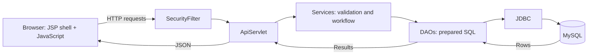
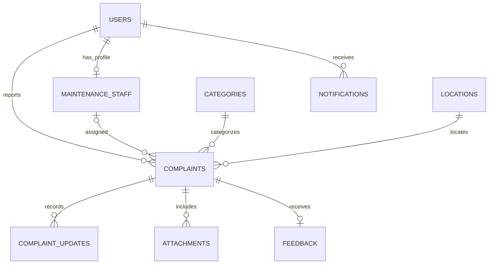

# CampusFix — project walkthrough

**Campus Issue & Maintenance Management System · VIT Vellore**

> “CampusFix connects students and faculty with campus administration and maintenance teams. A complaint has an owner, an assigned team, a deadline and a visible history until it is resolved and rated.”

## Start here

Open `CampusFix.code-workspace` in VS Code. Its Explorer separates **Frontend**, **Backend**, **Database**, **Tests** and **Project**.

In the project terminal:

```powershell
npm run dev
```

Visit **http://127.0.0.1:8080/campusfix/**. If you changed source files while the server was running, use `npm run restart` to deploy the current WAR.

Use the real application during your explanation. Account details are in the private local files `.runtime/local/ADMIN-LOGIN.txt` and `.runtime/local/SAMPLE-ACCOUNTS.txt`. Do not show these files on a projector.

## What to demonstrate — about 8 minutes

| Time | Screen / action | Explain |
| --- | --- | --- |
| 1 minute | Landing page, then Student login | One campus workspace; the server selects the role from the account. |
| 2 minutes | Report an issue, then My Complaints | Choose type → block → floor → room; add category, urgency and optional photos. Open the complaint to show its timeline. |
| 2 minutes | Admin → All complaints → complaint details | Review the report, confirm priority and assign an available maintenance specialist. Show the SLA badge. |
| 1 minute | Staff → Assigned to me | Start work, record a progress remark, then submit the repair for reporter confirmation. The staff account only sees its assigned complaints. |
| 1 minute | Return to the reporting Student | Confirm the repair, submit a rating and feedback, then show that it closes. |
| 1 minute | Admin → Analytics, Users and Settings | Show block statistics, staff performance, user roles, reporting limits and SLA policy. |

Use different browsers or separate browser profiles for Student, Admin and Staff if you want their sessions to remain open together. Tabs in the same browser normally share the same login session.

Existing records already cover each workflow stage, so you can explain the screens without changing records. Creating or updating a complaint changes the real local database.

## Architecture to explain



Tomcat serves the JSP shell, JavaScript, styles and Servlet API. JavaScript renders most of the interactive screens and requests JSON from the Servlet. JSP is the entry view, rather than a separate server-rendered JSP for every page.

`npm run dev` is a convenience command. It invokes a Python launcher that starts MySQL and the Java application in Tomcat. Node.js is not the backend.

## Code files to open, in order

Paths below are relative to the main project folder.

| File | What it does | A useful thing to point at |
| --- | --- | --- |
| `src/main/webapp/WEB-INF/views/shell.jsp` | Shared HTML document and asset imports | One consistent shell across all roles. |
| `src/main/webapp/assets/app.js` | Login, core screens, forms and API calls | `api()`, `renderShell()` and `submitReport()`. |
| `src/main/webapp/assets/enhancements.js` | Users, settings, SLA/history and analytics screens | Reporting settings are loaded from the real API. |
| `src/main/webapp/assets/experience.js` | Login refinements and clickable lifecycle overview | Counts come from the current user's accessible complaints. |
| `src/main/java/edu/vit/campusfix/SecurityFilter.java` | Authentication, session checks, CSRF and response headers | A hidden button alone is not authorization. |
| `src/main/java/edu/vit/campusfix/ApiServlet.java` | HTTP routes, JSON, uploads and login | `POST /api/complaints` reaches the report service. |
| `src/main/java/edu/vit/campusfix/ComplaintService.java` | Report validation and permitted transitions | `validateReport()` and `validateTransition()`. |
| `src/main/java/edu/vit/campusfix/ComplaintDao.java` | SQL, complaint persistence, timeline and notifications | A transaction commits the related records together. |
| `src/main/java/edu/vit/campusfix/Database.java` | Environment-based JDBC connections and prepared-statement helpers | Connection settings are not hardcoded account credentials. |
| `database/schema.sql` | Tables, relationships and indexes | Complaints reference users, categories and locations. |
| `src/main/java/edu/vit/campusfix/SlaService.java` | Deadline calculation and overdue escalation | Repeated scans avoid duplicate notices for the same Admin and complaint. |
| `src/main/java/edu/vit/campusfix/AnalyticsService.java` | Staff, block and recurring-issue calculations | Analytics use stored complaints and feedback. |
| `pom.xml` | Dependencies, Java target, test/build plugins and WAR packaging | Maven packages `target/campusfix.war`. |

## Explain one complete request

1. A Student submits the report form. JavaScript sends multipart form data with optional photos.
2. `SecurityFilter` checks the authenticated session and CSRF token.
3. `ApiServlet` handles uploads and delegates to `ComplaintService`.
4. The service checks category, priority, location and reporting policy.
5. `ComplaintDao` inserts the complaint, attachment metadata, first timeline event and notifications inside a database transaction.
6. The Servlet returns the complaint ID as JSON. The interface refreshes the complaint list from MySQL.

Photo files are stored outside the web root; MySQL stores their metadata. Reading a photo requires authorization to its associated complaint.

## Roles and permissions

| Role | Main responsibilities |
| --- | --- |
| Student | Report, track own complaints, receive updates and rate resolved work. |
| Faculty | Report academic-building issues, track own complaints and provide feedback. |
| Admin | Review, prioritize, assign staff, manage users/settings and inspect analytics. |
| Maintenance Staff | See assigned work, start repairs, record updates and submit fixes for reporter confirmation. |

Accounts with disabled access cannot sign in. Password resets and role changes invalidate previous session versions. BCrypt hashes are stored in the database.

## Workflow and SLA

```text
Reported → In Review → Assigned → In Progress → Awaiting Confirmation → Resolved → Feedback → Closed
```

Admin may assign a reported issue directly after reviewing it, so an explicit In Review event is optional in the implementation. Feedback is an action on a resolved complaint; it closes the complaint rather than creating a separate persisted Feedback status.

Default deadlines are **Urgent 4h**, **High 24h**, **Medium 48h**, **Low 72h**. The final 20% of the target is approaching deadline. An unresolved complaint past its deadline is overdue and requires escalation. Admin can change these targets in Settings.

The background monitor checks periodically; the local default is 60 seconds. Notifications are **in-app**, not email or SMS.

Recurring issues are groups of at least two complaints in the previous 30 days sharing category, location type, block and floor. They are a rule-based signal for investigation, not machine learning.

## Database relationships



The diagram is a simplified logical view. The SQL schema is the source of truth for foreign keys and constraints.

## Questions your teacher may ask

| Question | Answer |
| --- | --- |
| Why a service layer? | It separates business rules from HTTP routing and database queries, and makes rules easier to test. |
| Why a DAO? | SQL and JDBC resource handling stay in one layer instead of being scattered across views. |
| How is SQL injection avoided? | User values are bound to prepared statements, rather than concatenated into SQL. |
| Can a Student change the role in the browser? | Changing local UI data does not grant server access. The server checks the authenticated account and role. |
| Why use transactions? | A complaint and its related timeline/notification changes should commit together or roll back together. |
| How do you prevent duplicate feedback? | Only the reporter can rate a resolved complaint; row locks, state checks and database uniqueness protect the update. |
| How is overdue status calculated? | Creation time plus the configured priority target defines the deadline. Resolution stops the SLA clock. |
| What happens after restarting? | The persistent MySQL data directory and external upload directory retain records and photos. |
| How is it tested? | Java tests validate rules and database operations; HTTP checks exercise the WAR on actual MySQL/Tomcat; frontend tests cover CSV export. |
| Is it production-hosted? | This installation runs locally on loopback. Public deployment needs hosting, HTTPS and deployment-specific configuration. |

## Verification and limits

The reviewed backend passed **59 Java tests** and **75 MySQL/Tomcat HTTP checks**; the interface now has **3 frontend regression tests**. See `docs/build-verification.json` and `docs/deployment-smoke-results.json` for current saved evidence.

The local presentation accounts use the simple passwords requested for this installation. Password storage still uses BCrypt; these account passwords should be changed before any public deployment. Charts, Bootstrap, icons and fonts use CDNs, so prepare an internet connection for the complete visual experience.

## Closing explanation

> “The project combines a role-aware interface with server-side authorization, transactional complaint workflows, configurable service targets and analytics from stored data. It gives campus maintenance a clear path from report to resolution.”

## Student hostel residence

Admin assigns a student hostel under Users → Edit → Student hostel block. A student can submit hostel complaints only for that assigned block; an unassigned student must contact Admin first. Academic reporting remains available. The Servlet uses the authenticated residence, and backend validation rejects another block even when submitted manually. Changing the residence invalidates existing sessions. Existing complaint history is preserved.

The additive migration adds `users.hostel_block`; no existing complaints are deleted. Verified with 59 Java tests and 75 HTTP checks on MySQL/Tomcat, including forged block submissions.

## Student signup and reporting permissions

The login screen links to Student signup. Students provide their name, VIT email, password and required hostel block. The server creates only a STUDENT account, hashes the password with BCrypt and stores the selected hostel. Existing emails cannot be registered again. The signup endpoint is rate limited. Faculty, Admin and Staff accounts remain Admin-managed.

Students may report in every academic building (PRP, SJT, TT and SMV) and only their stored hostel block. Faculty may report only in academic buildings and cannot submit hostel complaints. Both the form and backend enforce this policy. Admin changes hostel assignments if a student moves; residence is not reselected on every login. Existing complaint history is retained.

The signup block is declared by the student; it is not an external verification of VIT hostel allocation. Admin can review and correct it. No email verification service is configured.

Current validation: 59 Java tests, 3 frontend regression tests, 75 real MySQL/Tomcat HTTP checks.
